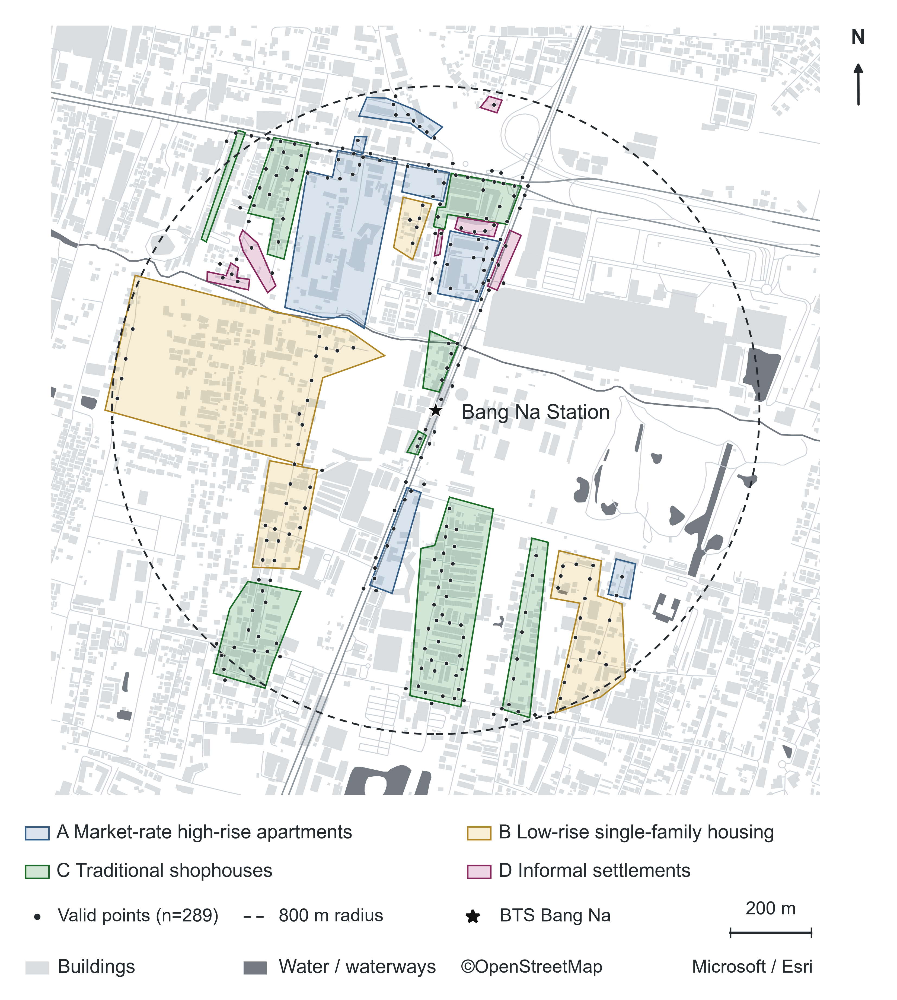
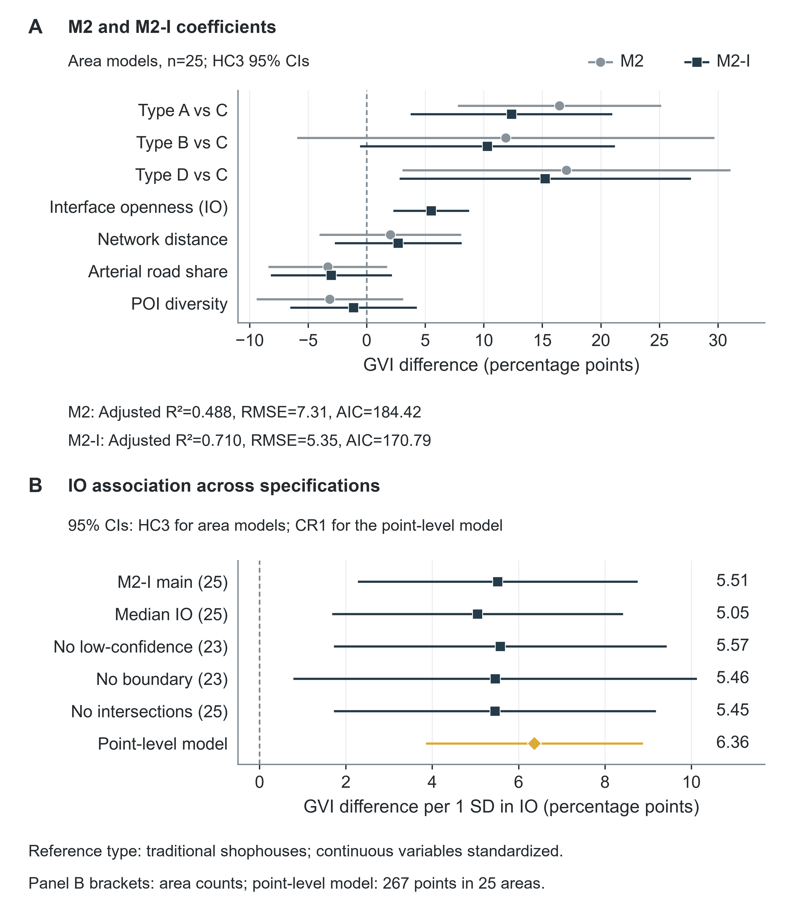

# Residential types, street interfaces and greenery in Bang Na

[← Research overview](../../README.md)

**Zihao Lin and Lei Shao · Research manuscript · Bangkok, Thailand**

## Research question

How do residential types and the interface between buildings and public streets
relate to visible greenery in a peripheral transit-oriented development station area?

## Study area

<a href="../../assets/bangna/study-area-figure02.png"></a>

**Manuscript Figure 2 — residential types and sampling locations.** Colours
distinguish the four residential types; dots mark valid GVI points. The dashed
800 m circle defines the polygon-selection criterion, not a walking catchment.
Original map credits are retained: © OpenStreetMap; Microsoft / Esri.

## Research workflow

- Process **1,156 directional images at 289 points** across **25 residential areas**.
- Measure vegetation-only GVI after removing the bottom 40 pixels of each
  640 × 640 image, using pretrained semantic segmentation.
- Combine setback, visual permeability and reversed vehicle occupation in an
  interface-openness index; 267 points have valid interface observations.
- Derive network distance, major-road share and POI diversity variables.
- Compare residential types, estimate area-level models with HC3 covariance,
  and examine alternative aggregation and sample rules.

## Selected results

| Model | Adjusted R² |
| --- | ---: |
| Residential types + three spatial controls (M2) | 0.488 |
| M2 + interface openness (M2-I) | 0.710 |

In M2-I, one SD higher interface openness is associated with **5.51 percentage
points higher GVI** (HC3 95% CI 2.27–8.75; 25 areas). The controls are mean
network distance to the BTS station, major-road share and mean POI Shannon
diversity in 400 m buffers.

<a href="../../assets/bangna/model-results-figure05.png"></a>

**Manuscript Figure 5 — model comparison and robustness.** Panel A compares
coefficients before and after adding interface openness. Panel B shows its
association across alternative specifications, with HC3 intervals for area
models and CR1 intervals for the point-level model. Both figures are unchanged
from the English v4 manuscript dated 22 October 2026. Open either image for
the full-resolution figure.

## Code and reproducibility

[Research code and run instructions](code/README.md) include the original
interface-analysis and regression routines, numerical segmentation and spatial
metrics, plus the historical image-inference and GIS scripts. The portable
runner starts with the included point and area tables.

```sh
python -m pip install -r projects/bangna/code/requirements.txt
python projects/bangna/code/run_analysis.py --output outputs/bangna
```

Run from the repository root. Both main models, seven sensitivity models and
the area-clustered point model have been checked against the archived results.
The runner uses final manual interface scores. Historical image inference and
GIS workflows require external inputs; see [provenance and scope](code/PROVENANCE.md).
The compact [HC3 verification example](../../examples/verify_bangna.py) is retained.

## Interpretation

The model describes conditional associations. Equal-area and point-weighted
summaries answer different questions. The sample uses an 800 m Euclidean station
buffer to select intersecting residential polygons; it is not an 800 m walking
catchment. Unlike Beijing, the main Bang Na GVI includes vegetation only.

**Tools:** Python, NumPy, pandas, SciPy, NetworkX, GluonCV/MXNet, Matplotlib.

**Manuscript:** *Residential types, street interfaces and variation in the green
view index along public streets in a peripheral TOD station area: Bang Na, Bangkok*.

[Authorship and research notes](../../docs/RESEARCH_NOTES.md)
