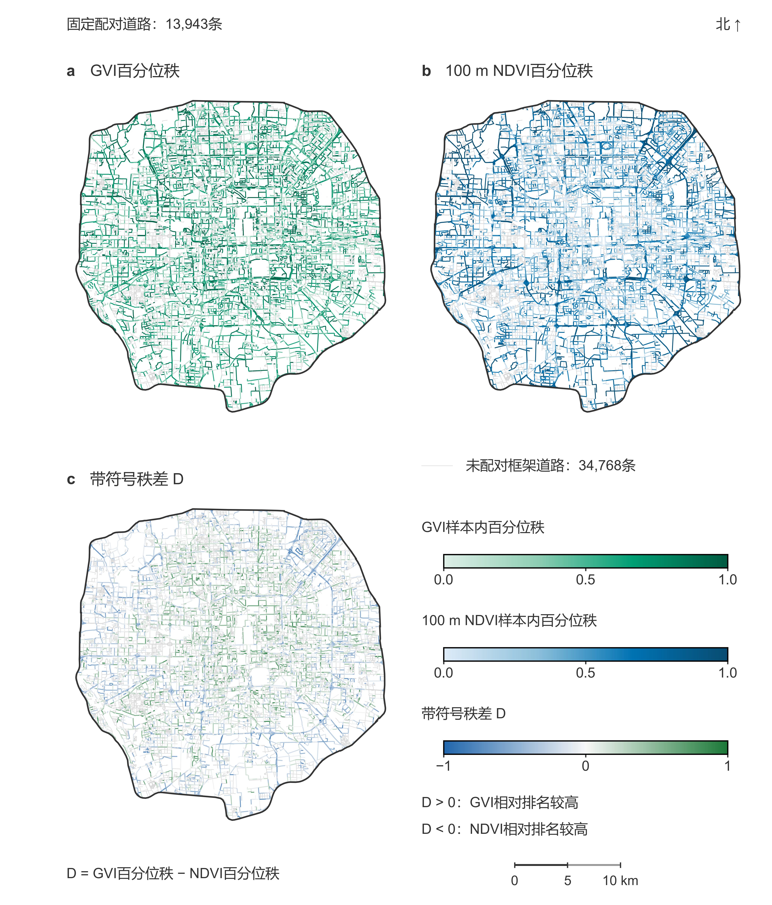
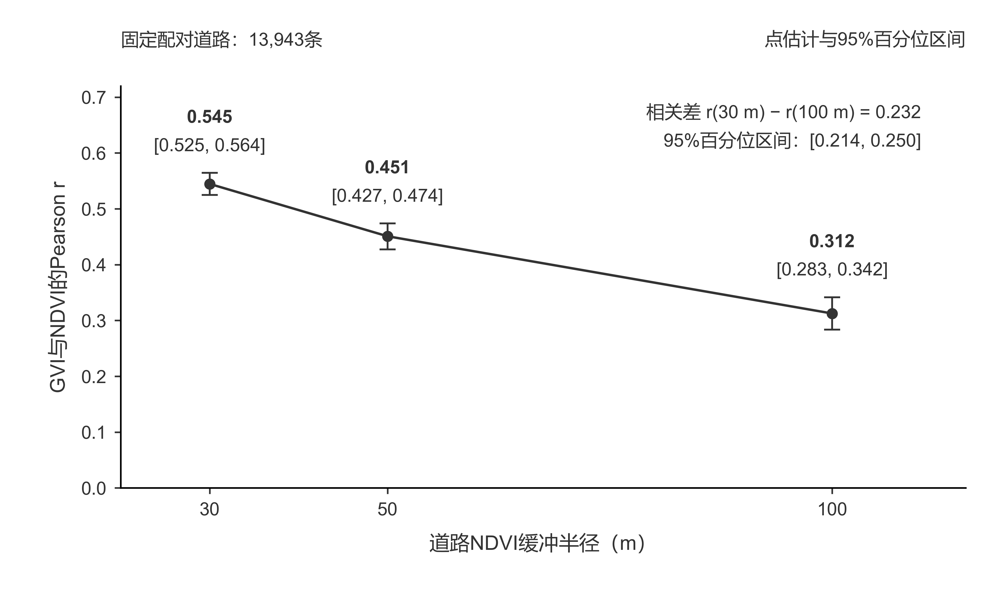

# Street-view and satellite greenness in Beijing

[← Research overview](../../README.md)

**Zihao Lin · Research manuscript · Beijing, China**

## Research question

How does the spatial extent of satellite measurement change its relationship
with street-view greenery on the same roads?

## Spatial comparison

<a href="../../assets/beijing/spatial-ranks-figure09.png"></a>

**Manuscript Figure 9 — spatial ranks on 13,943 paired roads.** Panels a–c show
GVI rank, 100 m NDVI rank and their difference, D = GVI rank − NDVI rank.
Positive D means a higher relative GVI rank; negative D means a higher NDVI rank.
Grey lines show unpaired framework roads. Road data: ©
[OpenStreetMap contributors](https://www.openstreetmap.org/copyright).

## Research workflow

- Curate street-view observations through content deduplication and road matching.
- Apply pretrained semantic segmentation and aggregate the vegetation + terrain
  fraction to roads.
- Summarise native-grid Landsat NDVI with pixel–buffer intersection-area weights.
- Keep **13,943 paired road segments** fixed when comparing 30, 50 and 100 m buffers.
- Examine correlations, within-sample ranks, median-based categories and spatial
  block-bootstrap uncertainty.

## Selected results

| Road-buffer radius | Pearson r | 95% spatial-block bootstrap CI |
| --- | ---: | --- |
| 30 m | 0.545 | 0.525–0.564 |
| 50 m | 0.451 | 0.427–0.474 |
| 100 m | 0.312 | 0.283–0.342 |

At 100 m, 5,400 roads (38.73%) have discordant high/low classifications. Between
30 and 100 m, 2,810 roads (20.15%) change category. “High” means at or above the
corresponding fixed-sample median. Intervals use 2 km blocks and 4,999 resamples.

<a href="../../assets/beijing/scale-association-figure07.png"></a>

**Manuscript Figure 7 — scale-dependent association.** The horizontal axis is
road-buffer radius; the vertical axis is Pearson r between road GVI and NDVI.
The same roads are compared at all three scales; error bars are 95% spatial-block
bootstrap intervals. Both figures retain the original Chinese labels from the
21 October 2026 manuscript. Open either image for the full-resolution figure.

## Code and reproducibility

[Research code and run instructions](code/README.md) include original routines
for content deduplication, road aggregation, physical NDVI, pixel-area weighting,
spatial block bootstrap and Moran's I. The portable entry point recomputes the
spatial analysis from 13,943 paired roads and checks the archived results.

```sh
python -m pip install -r projects/beijing/code/requirements.txt
python projects/beijing/code/run_analysis.py --output outputs/beijing
```

Run from the repository root. The three grid sizes, 4,999 bootstrap resamples
and 999-permutation Moran diagnostic have been checked against the research
archive. Upstream image and GIS processing requires external inputs; see
[provenance and scope](code/PROVENANCE.md). A smaller, standard-library
[correlation check](../../examples/verify_beijing.py) is also retained.

## Measurement scope

The Beijing street-view metric combines the Cityscapes vegetation and terrain
classes. Street-view dates span 2013–2023; the Landsat scene is from 7 September
2021. Category transitions describe measurement sensitivity, not changes in real
vegetation or model accuracy.

**Tools:** Python, NumPy, GeoPandas, Shapely, rasterio/GDAL, GluonCV/MXNet.

**Manuscript:** *A Road-Segment Comparison of Street-View GVI and NDVI:
Scale-Dependent Associations and Classification Differences within Beijing's
Fifth Ring Road*.

[Source and license notes](../../docs/RESEARCH_NOTES.md)
