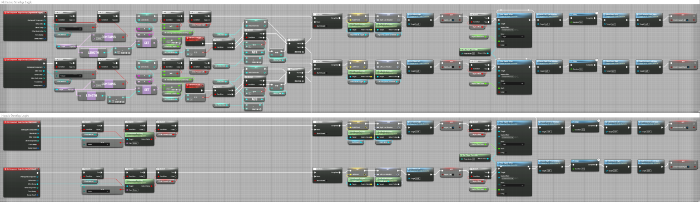

# UE climbing interaction and experiment logic

[← Thesis and architectural design](README.md) · [Research overview](../../README.md)

**Independent Blueprint development by Zihao Lin.**

## Implemented workflow

1. Read left/right controller grip input and identify a reachable hold.
2. Use hand–hold interaction to support virtual climbing.
3. Track successful grip events and compare their sequence with route labels.
4. Accumulate grip errors according to the experiment's route-index rule.
5. Finish the trial at the configured grip limit and display the error count.

The thesis describes a 30-grip limit, hand contact detection and haptic feedback.
Its original Blueprint figure includes object overlap logic, route/index checks,
branching and counters.

The [experimental-scene gallery](VISUALS.md#experimental-scenes) shows the four
virtual environments and the reference-route display used to communicate the task.

## Original Blueprint evidence

[](../../assets/grip-blueprint.png)

Figure 10 from the thesis, extracted without alteration. Open the image to inspect
the full graph. The image is evidence of the implementation; it is not a
downloadable or executable Blueprint asset.

## Retained UE project structure

The supplied UE folder contains a UE 5.4 project with the following named assets:

```text
MyProject2/
├── MyProject2.uproject
└── Content/Project_0412/
    ├── Blueprint/
    │   ├── BP_GripStaticMesh.uasset
    │   ├── Character/BP_VRCharacter.uasset
    │   ├── Gamecore/BP_VRGamemode.uasset
    │   └── player/BP_VRController.uasset
    ├── Input/
    │   ├── IA_LeftGrab.uasset
    │   ├── IA_RightGrab.uasset
    │   ├── IA_LeftThumbAxis.uasset
    │   ├── IA_RightThumbAxis.uasset
    │   └── IMC_VRInputContext.uasset
    └── MAPS/VRtest_0412.umap
```

The architecture folder also retains Rhino and Datasmith scene exports. These
materials document the modelling and engine workflow. The archived UE project
has not been relaunched or packaged as part of this repository preparation;
equivalence between this project snapshot and the final experiment build has
not been established.

## Dependencies and attribution

The retained project enables OpenXR and includes the VR Expansion/OpenXR
Expansion plugins by Joshua (MordenTral) Statzer, alongside Unreal starter
content. These are third-party dependencies; the claimed contribution is the
project-specific scene integration, interaction and experiment logic.

**Tools represented:** Unreal Engine 5.4, Blueprints, OpenXR, Rhino 8, Datasmith,
Pico VR and SteamVR.
