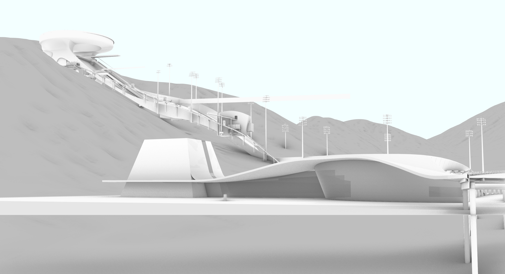

# Architectural enclosure and VR climbing decisions

[← Research overview](../../README.md)

**Zihao Lin · Undergraduate thesis and graduation design · 2025**  
School of Architecture, Tsinghua University. Supervisor: 张利 (Zhang Li).

## Research question

How can a VR climbing task help investigate the relationship between architectural
enclosure and route-following decisions?

The project connects an architectural proposal, *Yan Shuang Que* (岩双阙), in
Chongli, Zhangjiakou, with a behavioural experiment. A relatively enclosed training
hall and an open competition hall provide the spatial basis for the study.

## My contribution

- Architectural design and Rhino modelling of the climbing-centre proposal and
  experimental scenes.
- Independent development of the Unreal Engine climbing interaction and
  grip-error counting Blueprints.
- Experiment design linking scene conditions, a reference route and observable
  grip errors.
- Organisation of the VR study, analysis of the recorded results and integration
  of the research with architectural design development.

## Experimental design

| Component | Implementation |
| --- | --- |
| Scene conditions | Three competition-space conditions labelled 10%, 40% and 70% visible sky, plus a training-space condition |
| Environment | Rhino 8 models, Unreal Engine 5.4, Pico headset and PC streaming |
| Task | Follow a reference climbing route, with up to 30 grip events per trial |
| Behavioural measure | Grip error count, operationalised through route-index comparison |
| Analysis materials | Recorded observations, Jamovi output, thesis and defence presentation |

The thesis reports 20 recruited participants; its displayed result table contains
16 participant records per condition. This is an exploratory study of a virtual
task. It does not establish performance improvements in real or elite climbing.

## Programming evidence

The implementation links controller input, hand/hold interaction, route labels,
error accumulation and trial completion.

[Read the implementation note and view the original Blueprint figure](IMPLEMENTATION.md).

## Architectural outcome

Original architectural view from the graduation-design materials. The proposal
combines contrasting training and competition spaces with a landscape platform
and a connection to the surrounding Winter Olympic venue context.

## Research record

**Thesis:** 建筑空间围合度对攀岩决策表现的影响研究  
*Architectural enclosure and climbing decision performance* (English descriptive title).

**Design:** 岩双阙——基于空间形态–攀岩决策表现耦合模型的张家口攀岩中心设计.

This summary focuses on the experimental design, implemented system and
architectural outcome. See the [research notes](../../docs/RESEARCH_NOTES.md)
for the scope of the archived statistical results.
